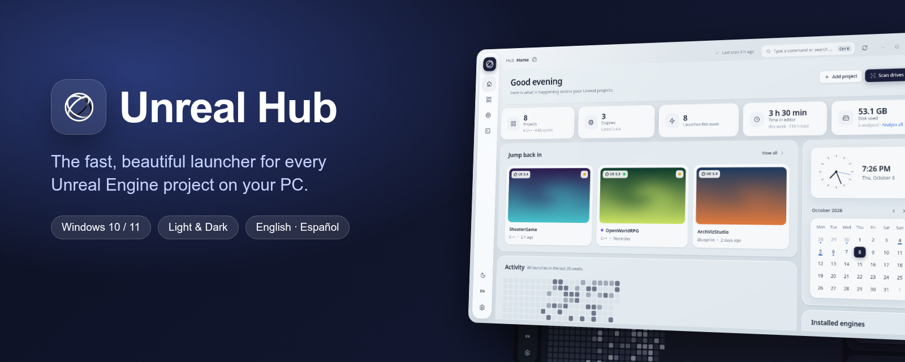
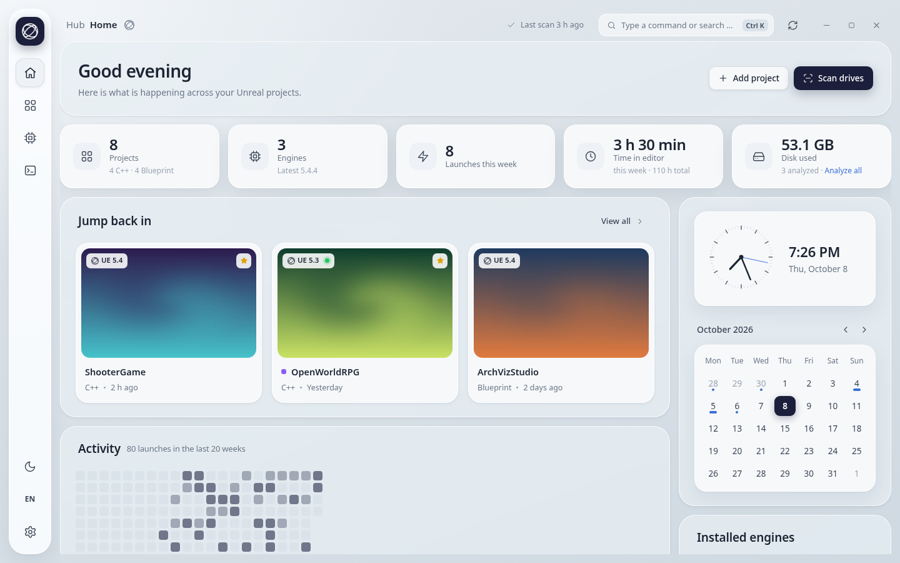
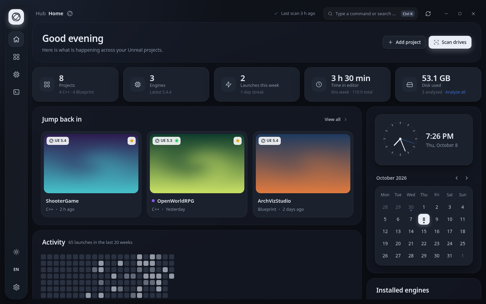
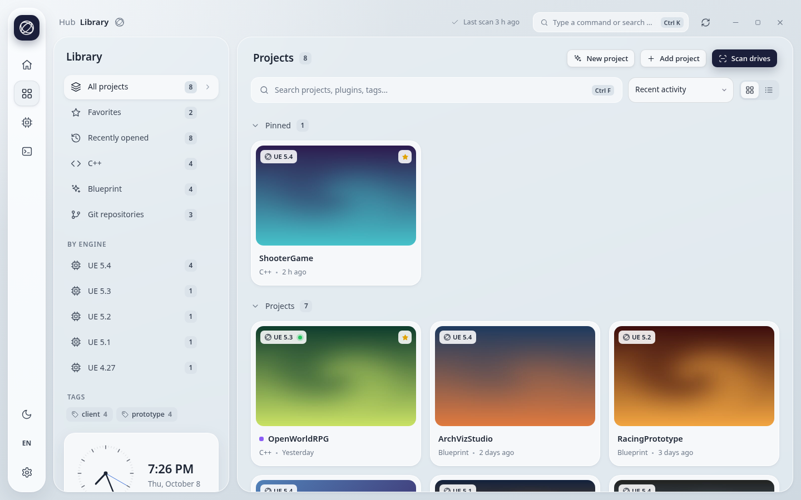
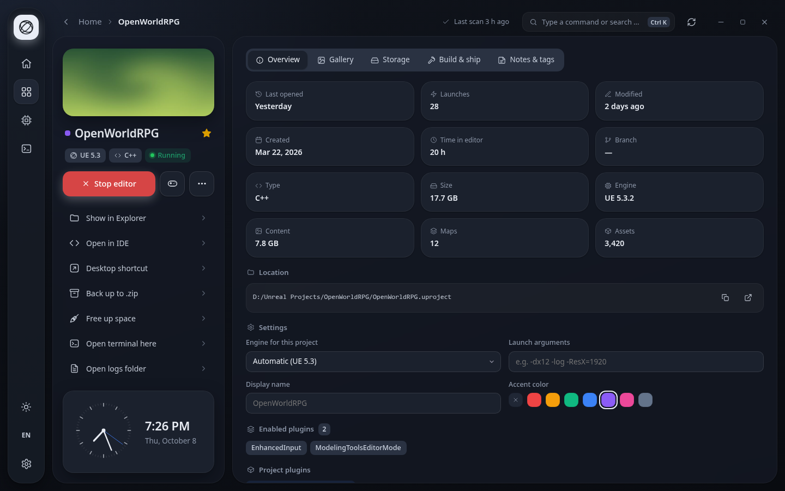
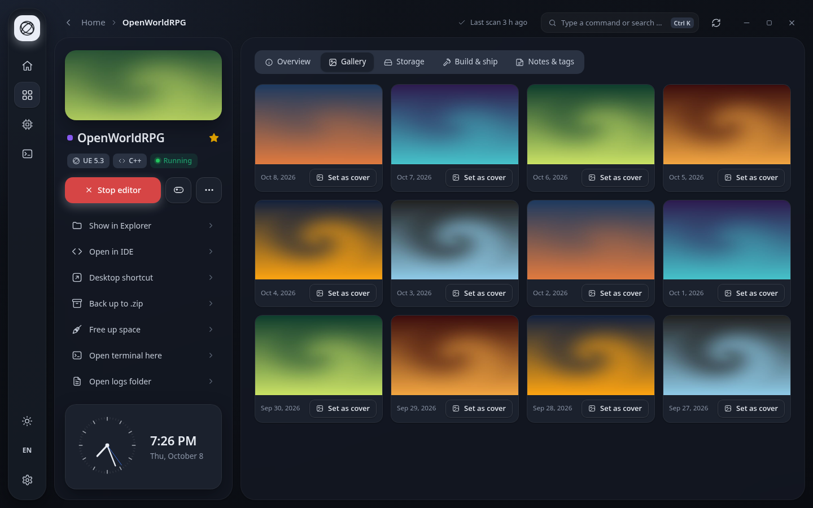
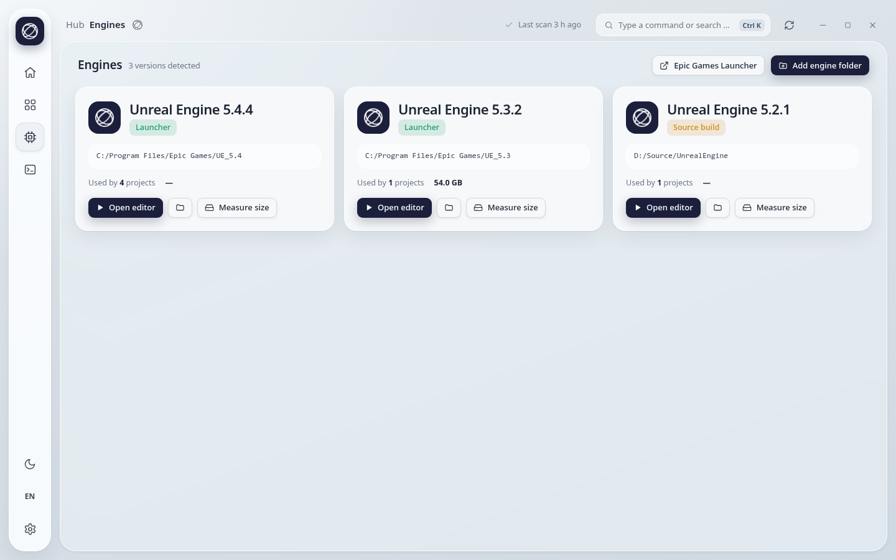
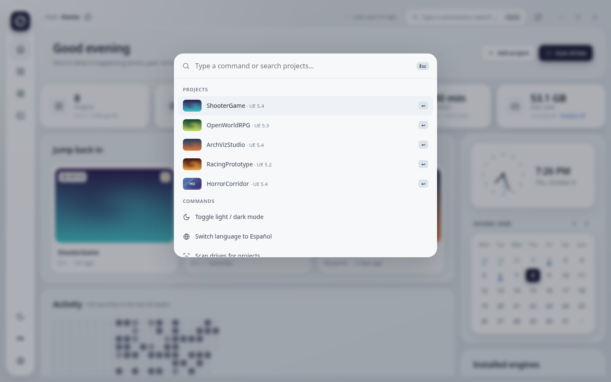
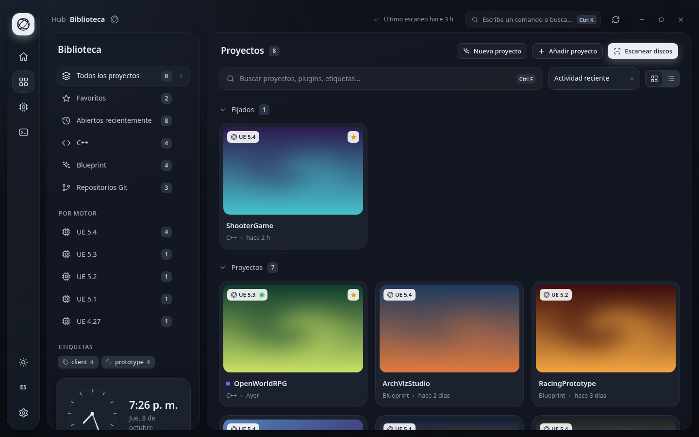
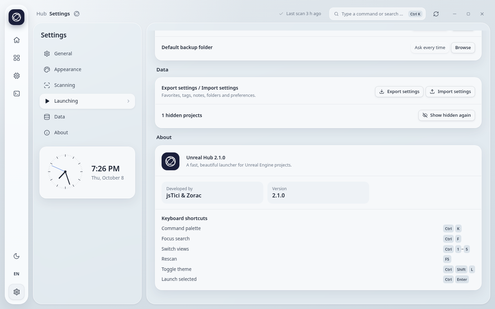

<div align="center">



<br/>


# Unreal Hub

**The fast, beautiful desktop launcher for every Unreal Engine project on your PC.**

Find all your projects in seconds, open them with one click, keep your engines tidy and see how you work — in a calm, glassy interface.

<br/>

[](https://github.com/TicianoDev/unreal-hub/releases/latest)
&nbsp;
[](https://github.com/TicianoDev/unreal-hub/releases)
&nbsp;
[](LICENSE)


[Features](#-features) · [Screenshots](#-screenshots) · [Install](#-install) · [Build from source](#-build-from-source) · [Credits](#-credits)

</div>

---

## Features

<table>
<tr>
<td width="50%" valign="top">

### Your whole library, automatically
- Scans every drive + Unreal's own recent list
- Real project thumbnails, engine version, C++ / Blueprint, Git branch
- Favorites, pins, tags, notes, colors and custom names
- Instant search & filters by engine, type or tag

</td>
<td width="50%" valign="top">

### One click to work
- Open in editor, play standalone or launch with custom args
- **Live editor tracking** — see what's running, stop it, time spent per project
- Desktop shortcuts with the project's own picture as icon
- Taskbar jump list & tray menu with your recent projects

</td>
</tr>
<tr>
<td valign="top">

### Project tools
- **Plugin manager**: enable / disable project, engine and Fab plugins without opening the editor, with warnings for missing or version-mismatched ones
- Generate project files, compile C++, package (BuildCookRun)
- Fix up redirectors & compile all Blueprints
- Zip backup, duplicate, switch engine version
- Storage cleanup (Intermediate, DDC, Saved, logs…) with real sizes

</td>
<td valign="top">

### Made to feel good
- Soft-glass dashboard with clock, calendar & activity heatmap
- **Free on Fab**: the limited-time free assets with a countdown, one click to claim
- **Fab library**: browse the Fab / Vault assets already downloaded on your PC (plugins, content packs, projects) with thumbnails, compatible UE versions and a link to each one on Fab
- Animated loading screen; a second launch just brings the open window to the front
- **Ideas from anywhere**: <kbd>Win</kbd> + <kbd>Alt</kbd> + <kbd>U</kbd> captures your screen and a note for the current project, even inside the editor
- **Moodboard** per project (images, notes, colors, links) and a **reference overlay** that floats your pinned references over the Unreal editor (<kbd>Win</kbd> + <kbd>Alt</kbd> + <kbd>O</kbd>)
- Light / dark / system theme and 7 accent colors
- **English** (default) and **Español**
- Command palette <kbd>Ctrl</kbd> + <kbd>K</kbd>, drag & drop, keyboard shortcuts

</td>
</tr>
<tr>
<td valign="top">

###  Gallery
- Browse every screenshot saved by your project
- Set any of them as the project cover in one click

</td>
<td valign="top">

###  Trustworthy
- No accounts, no telemetry — the only network requests are the optional **Free on Fab** panel and the update check on GitHub (both can be turned off in Settings)
- Per-user install, **no admin rights**
- Clean uninstaller — your projects are never touched

</td>
</tr>
</table>

---

## 📸 Screenshots

<div align="center">

### Home


<br/><br/>

<table>
<tr>
<td align="center"><br/><sub><b>Dark mode</b></sub></td>
<td align="center"><br/><sub><b>Library</b> — filters by engine, type & tags</sub></td>
</tr>
<tr>
<td align="center"><br/><sub><b>Project page</b> — live editor session & tools</sub></td>
<td align="center"><br/><sub><b>Gallery</b> — screenshots & covers</sub></td>
</tr>
<tr>
<td align="center"><br/><sub><b>Engines</b> — Launcher & source builds</sub></td>
<td align="center"><br/><sub><b>Command palette</b> — <kbd>Ctrl</kbd>+<kbd>K</kbd></sub></td>
</tr>
<tr>
<td align="center"><br/><sub><b>Español</b> 🇪🇸</sub></td>
<td align="center"><br/><sub><b>Settings</b> & About</sub></td>
</tr>
</table>

</div>

---

## 📦 Install

1. Download **`UnrealHub-Setup-2.4.0.msi`** from [**Releases**](https://github.com/TicianoDev/unreal-hub/releases/latest).
2. Run it — it installs for your user only (no admin rights) and creates desktop and Start menu shortcuts.
3. Done — Unreal Hub scans your drives and shows all your projects.

**Updates:** from 2.2.0 on, Unreal Hub checks GitHub Releases by itself and tells you when a new version is out. Download and install it from **Settings › About**; the SHA-256 checksum is verified before installing.

> [!NOTE]
> The installer is not code-signed yet, so Windows SmartScreen may show *"Windows protected your PC"*. Click **More info → Run anyway**. You can verify the file with the SHA-256 checksum published in each release.

**Requirements:** Windows 10 or 11 (x64) and at least one Unreal Engine installed (Epic Games Launcher or source build).

---

## Build from source

```bash
git clone https://github.com/TicianoDev/unreal-hub.git
cd unreal-hub
npm install
npm start            # run in development
```

**Windows installer**

```powershell
npm run dist         # -> dist/UnrealHub-Setup-<version>.msi
```

Requires [Node.js 18+](https://nodejs.org). electron-builder downloads WiX by itself.

**Publishing a release** (installed copies update from it): bump `version` in `package.json`, run `npm run dist`, then create a GitHub release tagged with that version (e.g. `2.2.0`) and attach the `.msi` plus a `SHA256SUMS.txt`. Keep the MSI `upgradeCode` unchanged so each version replaces the previous one.

<details>
<summary><b>Project structure</b></summary>

```
src/
├─ main.js            Electron main process (scanning, launching, tasks, tray, jump list)
├─ preload.js         Safe bridge between UI and system
├─ assets/            App icon & logo
└─ renderer/          UI — index.html, styles.css, app.js, i18n.js (EN/ES), icons.js
```

</details>

---

## ⌨️ Keyboard shortcuts

| Action | Shortcut |
|---|---|
| Command palette | <kbd>Ctrl</kbd> + <kbd>K</kbd> |
| Focus search | <kbd>Ctrl</kbd> + <kbd>F</kbd> |
| Switch views | <kbd>Ctrl</kbd> + <kbd>1</kbd>–<kbd>6</kbd> |
| Rescan drives | <kbd>F5</kbd> |
| Toggle theme | <kbd>Ctrl</kbd> + <kbd>Shift</kbd> + <kbd>L</kbd> |
| Launch selected | <kbd>Ctrl</kbd> + <kbd>Enter</kbd> |

---

## 💜 Credits

<div align="center">

Designed & programmed by **jsTici** and **Zorac**.

Icons: Windows Segoe Fluent Icons and the real icons of your installed programs

*Unreal® and Unreal Engine® are trademarks of Epic Games, Inc. This project is not affiliated with or endorsed by Epic Games.*

<br/>

Released under the [MIT License](LICENSE) · If you like it, leave a ⭐

</div>
